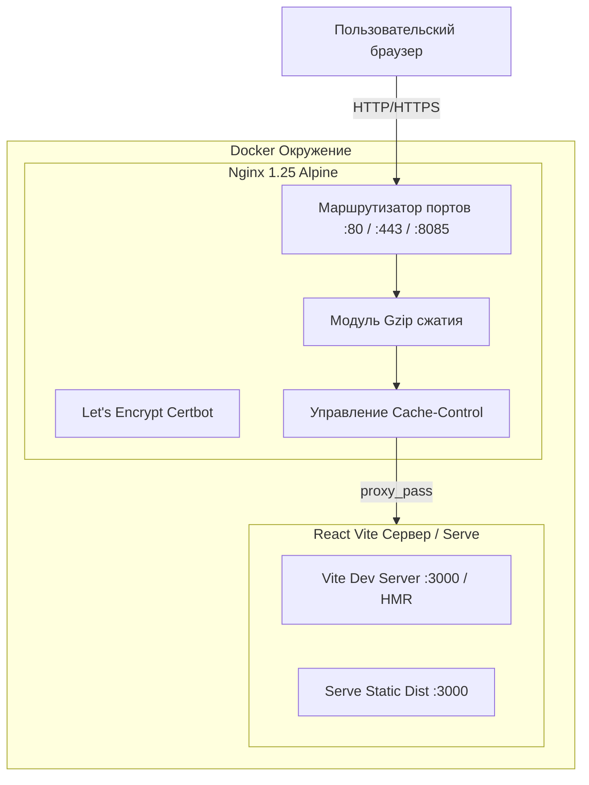

# System Patterns: Архитектура и паттерны проектирования

## 1. Архитектурная диаграмма

---

## 2. Ключевые паттерны в кодовой базе

### 2.1. Atomic / Модульный дизайн компонентов
Код четко декомпозирован по зонам ответственности:
* `@ui/` — низкоуровневые презентационные примитивы без бизнес-логики (`Button`, `Input`, `Textarea`, `Card`, `Badge`, `Container`, `PhoneInput`).
* `@layout/` — каркас страниц (`Header`, `Footer`, `MainLayout`, `Breadcrumbs`).
* `@navigation/` — компоненты навигации (`MobileMenu`).
* `@components/common/` — кросс-секционные интерактивные элементы (`CallbackModal`, `DiscussionModal`, `AnimatedSection`, `ScrollToTop`, `SocialIcons`, `LoadingSpinner`).
* `@components/sections/` — смысловые блоки страниц (`HeroSection`, `ServicesSection`, `TariffsSection`, `CasesSection`, `FAQSection`, `ContactForm` и др.).
* `pages/` — сборные экраны, использующие компоненты секций и мета-теги.

### 2.2. Ленивая загрузка и Code-Splitting
* Все 11 страниц загружаются через `React.lazy()` с оберткой `<Suspense fallback={<PageFallback />}>`.
* В [vite.config.ts](file:///d:/Разные%20проекты/Частный%20СЕО%20специалист/site/vite.config.ts) настроены изолированные чанки библиотек (`manualChunks`):
  * `react-vendor`: react, react-dom, react-router-dom
  * `ui-vendor`: lucide-react, swiper
  * `motion-vendor`: framer-motion (анимации скролла)
  * `forms-vendor`: react-hook-form, @hookform/resolvers, zod, libphonenumber-js, react-phone-input-2

### 2.3. Паттерн управления формами и валидации (DRY)
* Каждая форма декларируется схемой [Zod](file:///d:/Разные%20проекты/Частный%20СЕО%20специалист/site/src/utils/callbackValidation.ts) и подключается через `zodResolver`.
* Валидация телефонов вынесена в универсальный хелпер [phoneValidation.ts](file:///d:/Разные%20проекты/Частный%20СЕО%20специалист/site/src/utils/phoneValidation.ts) с проверкой через `libphonenumber-js`.
* Формы возвращают типизированные структуры TypeScript (`CallbackFormData`, `DiscussionFormData`, `ContactFormData`).

### 2.4. Паттерн генерации микроразметки Schema.org
* Вынесен в отдельный генератор [src/utils/schemaGenerators.ts](file:///d:/Разные%20проекты/Частный%20СЕО%20специалист/site/src/utils/schemaGenerators.ts).
* Поддерживает функции `generateLocalBusinessSchema()`, `generateArticleSchema()`, `generateFAQPageSchema()`, `generateWebPageSchema()`.
* Разметка инжектируется в `<head>` в формате `<script type="application/ld+json">` через `react-helmet-async`.

### 2.5. Стратегия кэширования окружений
* **Dev (разработка)**: Nginx проксирует запросы на `app:3000` без кэширования статики, разрешает WebSockets для мгновенного Vite HMR.
* **Prod (боевой сервер)**:
  * Статические чанки (`.js`, `.css`, изображения, шрифты) кэшируются на 365 дней (`Cache-Control: public, immutable`).
  * Файл `index.html` имеет директиву `no-cache, no-store, must-revalidate` для гарантированного обновления при выкатке нового релиза.

### 2.6. Паттерн создания контентных страниц (Data-Driven Architecture)
* Все коммерческие услуги (`/uslugi/:slug/`), статьи блога (`/blog/:slug/`) и кейсы (`/portfolio/:slug/`) формируются декларативно на основе типизированных модулей в каталоге `src/data/`:
  * `src/data/services/<slug>.ts` (интерфейс `Service`) -> регистрация в `src/data/index.ts`
  * `src/data/blog/<slug>.ts` (интерфейс `Article`) -> регистрация в `src/data/blog.ts` с автосортировкой по дате
  * `src/data/index.ts` (массив `cases: Case[]`) -> индивидуальные страницы кейсов
* Не требуется создавать отдельные JSX-компоненты или прописывать новые роуты в `App.tsx` — страницы рендерятся универсальными шаблонами с автогенерацией SEO-тегов и Schema.org.

