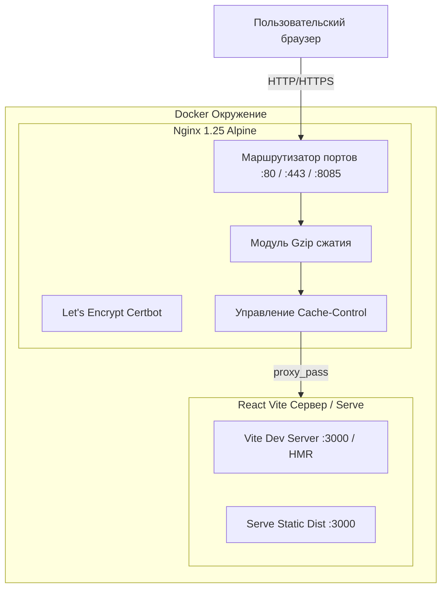

# System Patterns: Архитектура и паттерны проектирования

## 1. Архитектурная диаграмма



---

## 2. Ключевые паттерны в кодовой базе

### 2.1. Atomic / Модульный дизайн компонентов
Код четко декомпозирован по зонам ответственности:
* `@ui/` — низкоуровневые презентационные примитивы без бизнес-логики (`Button`, `Input`, `Textarea`, `Card`, `Badge`, `Container`, `PhoneInput`).
* `@layout/` — каркас страниц (`Header`, `Footer`, `MainLayout`, `Breadcrumbs`).
* `@navigation/` — компоненты навигации (`MobileMenu`).
* `@components/common/` — кросс-секционные интерактивные элементы (`CallbackModal`, `DiscussionModal`, `AnimatedSection`, `ScrollToTop`, `SocialIcons`, `LoadingSpinner`).
* `@components/sections/` — смысловые блоки страниц (`HeroSection`, `ServicesSection`, `TariffsSection`, `CasesSection`, `FAQSection`, `ContactForm` и др.).
* `pages/` — сборные экраны, использующие компоненты секций и мета-теги.

### 2.2. Ленивая загрузка и Code-Splitting
* Все 11 страниц загружаются через `React.lazy()` с оберткой `<Suspense fallback={<PageFallback />}>`.
* В [vite.config.ts](file:///d:/Разные%20проекты/Частный%20СЕО%20специалист/site/vite.config.ts) настроены изолированные чанки библиотек (`manualChunks`):
  * `react-vendor`: react, react-dom, react-router-dom
  * `ui-vendor`: lucide-react, swiper
  * `motion-vendor`: framer-motion (анимации скролла)
  * `forms-vendor`: react-hook-form, @hookform/resolvers, zod, libphonenumber-js, react-phone-input-2

### 2.3. Паттерн управления формами и валидации (DRY)
* Каждая форма декларируется схемой [Zod](file:///d:/Разные%20проекты/Частный%20СЕО%20специалист/site/src/utils/callbackValidation.ts) и подключается через `zodResolver`.
* Валидация телефонов вынесена в универсальный хелпер [phoneValidation.ts](file:///d:/Разные%20проекты/Частный%20СЕО%20специалист/site/src/utils/phoneValidation.ts) с проверкой через `libphonenumber-js`.
* Формы возвращают типизированные структуры TypeScript (`CallbackFormData`, `DiscussionFormData`, `ContactFormData`).

### 2.4. Паттерн генерации микроразметки Schema.org
* Вынесен в отдельный генератор [src/utils/schemaGenerators.ts](file:///d:/Разные%20проекты/Частный%20СЕО%20специалист/site/src/utils/schemaGenerators.ts).
* Поддерживает функции `generateLocalBusinessSchema()`, `generateArticleSchema()`, `generateFAQPageSchema()`, `generateWebPageSchema()`.
* Разметка инжектируется в `<head>` в формате `<script type="application/ld+json">` через `react-helmet-async`.

### 2.5. Стратегия кэширования окружений
* **Dev (разработка)**: Nginx проксирует запросы на `app:3000` без кэширования статики, разрешает WebSockets для мгновенного Vite HMR.
* **Prod (боевой сервер)**:
  * Статические чанки (`.js`, `.css`, изображения, шрифты) кэшируются на 365 дней (`Cache-Control: public, immutable`).
  * Файл `index.html` имеет директиву `no-cache, no-store, must-revalidate` для гарантированного обновления при выкатке нового релиза.

### 2.6. Архитектурный стандарт кластеров услуг (Папка сервис -> Папка комплексная услуга -> Папка подуслуга)
* Для всех многоуровневых услуг (начиная с SEO-аудита и будущих кластеров блога/услуг) принят строгий стандарт файловой структуры:
  ```
  src/pages/services/
  └── <cluster-name>/             <-- Папка комплексной услуги / основной раздел
      ├── index.tsx               <-- Страница общего раздела
      ├── <sub-service-1>/        <-- Папка специализированной услуги 1
      │   └── index.tsx           <-- 1 страница = 1 самодостаточный файл
      └── <sub-service-2>/        <-- Папка специализированной услуги 2
          └── index.tsx
  ```
* **Принцип автономности**: 1 страница = 1 файл `index.tsx` в своей поддиректории. Все данные, тарифы, чеклисты, Schema.org и FAQ хранятся прямо в файле страницы, исключая лишнюю фрагментацию и усложнение поддержки.

---

## 3. Критические стандарты качества кода и контента

### 3.1. 🛑 Полный запрет неоправданных англицизмов (ФЗ «О государственном языке РФ»)
**Критическое правило для всех будущих правок, компонентов, текстов, комментариев и коммитов:**
* Категорически запрещено использовать англицизмы, кальки и маркетинговый сленг при наличии общеупотребительных русских аналогов.
* **Таблица обязательных соответствий:**
  * *Хаб / Хаб услуг* ➔ **Единый центр / Основной раздел / Все виды услуг**
  * *Оффер* ➔ **Специальное предложение / Условия сотрудничества**
  * *Чек-лист / Чек-поинты* ➔ **Список проверок / Программа проверок / Параметры проверки**
  * *Краулинг / Краулер* ➔ **Сканирование / Автоматическое сканирование сайта**
  * *Краулинговый бюджет* ➔ **Лимит поискового сканирования**
  * *Юзабилити* ➔ **Удобство сайта / Удобство для пользователей**
  * *Чекаут / Checkout* ➔ **Оформление заказа**
  * *CJM* ➔ **Маршруты пользователей / Конверсионные пути**
  * *CRO* ➔ **Повышение конверсии**
  * *Бэклинки / Линкбилдинг* ➔ **Входящие внешние ссылки / Ссылочное продвижение**
  * *Бенчмарк* ➔ **Сравнительный анализ против лидеров ниши**
  * *E-commerce* ➔ **Интернет-магазины и каталоги**
  * *Для DEV / Девы* ➔ **Для разработчиков / Для программистов**
  * *Баги* ➔ **Технические ошибки и сбои**
  * *Loom / Скринкаст* ➔ **Видеозапись экрана с пояснениями**
  * *Аутрич / Сабмиты / Крауд* ➔ **Публикации в СМИ, партнерские статьи, отраслевые справочники**
  * *MindMap* ➔ **Наглядная схема структуры каталога**
  * *Интент запроса* ➔ **Цель поиска и потребности пользователей**
* **Разрешенная техническая терминология (исключения):**
  * SEO, HTML, CSS, JavaScript, React, URL, XML, robots.txt, sitemap.xml, Schema.org, HTTP/HTTPS, 200/301/404, Core Web Vitals, бренды Яндекс, Google, Telegram, Nginx.

### 3.3. 🛑 Запрет выделения ключевых фраз тегами strong / b (болд-спам)
* **Категорически запрещено** оборачивать поисковые запросы и ключевые слова в теги `<strong>`, `<b>` или применять к ним стили жирного начертания в основном тексте страниц.
* Поисковые фразы должны входить в предложения абсолютно естественно и читаться органично обычным шрифтом.
* Теги `<strong>` разрешено использовать исключительно для выделения ключевых смысловых выгод для человека: цен («от 10 000 ₽»), сроков («за 24 часа», «в течение 30 дней») или условий гарантий («засчитываем 100% стоимости»).

### 3.4. Стандарты разработки и комментариев
* Имя ведущего эксперта проекта: **Сергей Кошелев**.
* Все комментарии в коде, сообщения в логах, документация и описания коммитов пишутся **строго на русском языке**.
* Соблюдение принципа DRY и избегание дублирования кода.
* Строгая проверка типов TypeScript (`noEmit: true`, `noUnusedLocals: true`).


